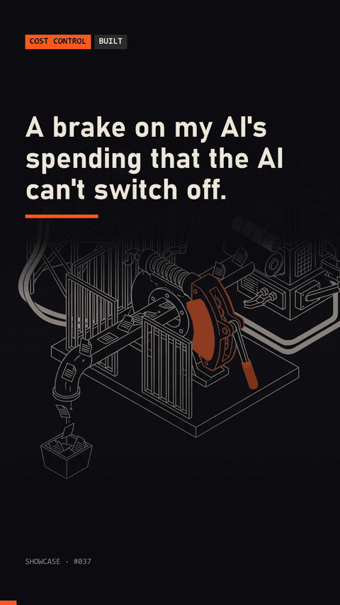

# usage-brake

A usage readout and a daily brake for Claude Code subscription limits. It shows the 5-hour and weekly percent with their reset times, projects when the weekly plan runs out at your current pace, and raises an alarm when you pass your daily share of what is left. A PreToolUse hook keeps the agent from switching the brake off, and can stop tool calls at a limit you set.



## Quick start

```
python demo.py
```

The demo replays a simulated week hour by hour: the readout on Tuesday and Wednesday, the alarms as the day's allowance is spent, the agent trying to disable the brake (denied), and the optional hard stop. It needs no account and makes no network call. Run the tests with `python -m unittest discover -s tests`.

For real use, point it at your usage:

```
export USAGE_BRAKE_TOKEN=...            # read from the environment only, never stored or printed
python -m usage_brake status            # readout for a terminal
python -m usage_brake statusline        # one line, for a status bar
python -m usage_brake check             # one brake evaluation; run it every 10-20 minutes from cron, launchd or Task Scheduler
```

Hooks for Claude Code (replace the path):

```json
{
  "statusLine": {"type": "command", "command": "python -m usage_brake statusline"},
  "hooks": {
    "PreToolUse": [{"matcher": ".*", "hooks": [{"type": "command", "command": "python /path/to/usage-brake/usage_brake/guard.py"}]}]
  }
}
```

## Requirements

Python 3.8+, standard library only. Notifications use `notify-send` (Linux), `osascript` (macOS) or a PowerShell toast (Windows); without them the alarm prints to the console.

## How it works

- `sources.py` reads usage from a pluggable source: `oauth` (the plan usage endpoint, token from `USAGE_BRAKE_TOKEN`, cached 5 minutes, last good answer served if a call fails), `file:<path>` (a JSON file in the same shape) or `sim` (the simulated week). The oauth endpoint is undocumented and may change; that is why the source is replaceable.
- `pace.py` logs a sample every few minutes and computes the recent rate from the oldest sample of the same window in the last 24 hours (5 hours for the 5-hour window). Samples from another window are ignored, and a drop in usage ends the look-back. With no history it falls back to the window average.
- `readout.py` turns that into the lines you see: percent, reset, the even-spread line, pace against the sustainable rate (points left divided by hours left), and the projected run-out time with how long a pause would fix it.
- `brake.py` sets a daily allowance when a new day or a new weekly window starts: points left in the week times the share of the remaining hours that fall today. Level 1 fires at 80% of it, level 2 at 100%, then one more level for each extra 25%. Each level fires once. A reading older than 60 minutes is not judged.
- `guard.py` denies tool calls that would loosen the brake: any `usage_brake` subcommand other than `status`, `statusline` and `check`, edits to its state folder, scheduler entries named for it. With `hard_stop_week_pct` or `hard_stop_five_pct` in `config.json` it denies every tool call once the last reading is at or over that number, until you run `python -m usage_brake override <minutes>` in your own terminal.
- The guard is a deterrent for an agent that follows its tool permissions. It is not a security boundary against a process running as you that is set on getting around it.
- State lives in `~/.usage-brake` (or `USAGE_BRAKE_HOME`). `USAGE_BRAKE_PROTECT` adds more protected paths.

## Results

Counts from the author's own scheduled brake log, 15 Sep to 25 Oct 2026, entries on 40 distinct days. Numbers only; nothing is estimated.

| Measure | Count |
| :--- | ---: |
| Daily allowances computed | 45 |
| Alarm events | 58 |
| Level 1 (80% of allowance) | 20 |
| Level 2 (100% of allowance) | 17 |
| Level 3 and above | 21 |
| Checks skipped because the reading was over an hour old | 12 |

These come from a PowerShell predecessor of this tool; this Python version is a rewrite with the same allowance and alarm levels.

## License

MIT, see [LICENSE](LICENSE).

Built with Claude Code.
